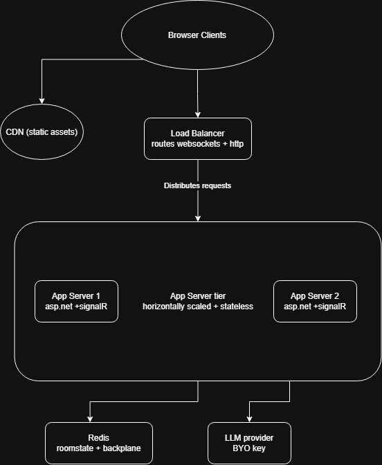

# Syncode

Syncode is a browser code editor where people edit the same project, chat, and run code together.

Create a room, share its invite link, and work in the same files from separate browser tabs or devices.

## Features

- Collaborative editing with shared cursors and participant presence
- A project explorer with nested folders, file operations, and room-wide changes
- Room chat, participant roles, join approval, and moderation controls
- Monaco editor with themes, language-aware completion, and formatting
- GitHub sign-in, repository import, review, and push workflows
- Isolated code execution, live browser preview, and interactive Bash terminals
- Container-based language servers for HTML, CSS, Python, C#, C/C++, Rust, and Java

## Run the full application locally

The local container stack uses Docker Compose and Docker Desktop with Linux containers. It starts the browser client, room server, Redis, and execution service. The execution service uses a privileged sibling Docker daemon to start runner containers, so this setup is for local development and must not be exposed as a public multi-user deployment.

Create `infra/.env` and set `SYNCODE_EXECUTION_API_KEY` to a random secret with at least 32 bytes.

To enable GitHub sign-in and repository actions, also set `GITHUB_CLIENT_ID`, `GITHUB_CLIENT_SECRET`, `GITHUB_TOKEN_ENCRYPTION_KEY`, and `GITHUB_REDIRECT_URI`. For the local default address, set the callback to `http://localhost:8080/github/callback` and set the GitHub OAuth app callback URL to the same value. If you change `CLIENT_PORT`, update the callback URL, the OAuth app callback, and `SYNCODE_ALLOWED_ORIGIN` to match.

Start the stack from the repository root.

```powershell
docker compose --env-file infra/.env -f infra/docker-compose.yml up --build
```

Open [http://localhost:8080](http://localhost:8080). To stop the services and keep room data and runner images, run this from another terminal.

```powershell
docker compose --env-file infra/.env -f infra/docker-compose.yml down
```

The client is available only on the local machine by default. Redis and the execution API also bind to loopback. Runner images are built into the sibling daemon before the execution service starts. The first start can take several minutes while Docker downloads and builds the language toolchains.

For package installation in a terminal, the local stack keeps package egress disabled. Enabling the package proxy requires a dedicated Linux worker with gVisor and a successful egress isolation check. Read [the execution service guide](execution-service/README.md) before changing that setting or deploying execution outside a local machine.

## Architecture



The browser client talks to the room server through the same origin. The room server coordinates SignalR rooms, GitHub actions, project state, and execution requests. Redis stores room data and relays SignalR and execution events. The execution service places jobs in a bounded queue and runs untrusted code in restricted containers.

Monaco's TypeScript language service handles JavaScript and TypeScript in the browser. HTML and CSS, Python, C#, C and C++, Rust, and Java use language servers in isolated execution-service containers. Those processes receive a room workspace snapshot, then follow shared document changes. They have no network access and do not receive platform credentials.

Build runner images after changing language-server versions or image setup with `infra/build-runner-images.sh`. Production execution requires the configured gVisor runtime. See [the execution service guide](execution-service/README.md) for local service commands, container limits, isolation checks, and deployment requirements.

## Scaling

The client is a static Vite build and can be served from a CDN. Multiple room-server instances can share Redis. Redis stores room state, capacity, and rate-limit data, while the SignalR Redis backplane distributes hub broadcasts. Keep Redis settings, room-capacity limits, allowed origins, execution-service URL and API key, and execution queue prefix consistent across instances.

The load balancer must support WebSockets and preserve SignalR session affinity while clients negotiate and connect. Redis backplane support does not replace affinity. Use the room server's `/health` endpoint for health probes.

Execution output is published through Redis Pub/Sub. Room-server instances elect one output relay at a time using a short Redis lease, then send events through the SignalR backplane. Execution workers can share the Redis queue and scale independently.

Interactive terminal sessions belong to the room-server connection that created them. They work across instances while SignalR affinity holds, but an instance restart or connection replacement does not restore an open shell. Room documents and membership are Redis-backed and reload after reconnect.

## Development

Install client dependencies from `client` with `npm ci`. Run `npm run dev` for the client, `dotnet run --project server/Syncode.Server.csproj --launch-profile http` for the room server, and use the execution service setup in its README. Run client checks with `npm run lint`, `npm test`, `npm run format:check`, and `npm run build`. Build the room server with `dotnet build server/Syncode.Server.csproj` and run execution-service tests with `dotnet test execution-service.tests/Syncode.ExecutionService.Tests.csproj`.

Changes should keep room authorization on the server, validate all imported paths and payload limits, and preserve the container boundaries around user code. Keep local credentials in ignored environment files and never add them to commits. The automated checks run client formatting, linting, tests and build, .NET build and tests, and container image builds on pushes and pull requests.

## License

Syncode is available under the MIT License. See [LICENSE](LICENSE) and
[third-party notices](client/THIRD-PARTY-NOTICES.md) for included assets and
dependency licenses.
